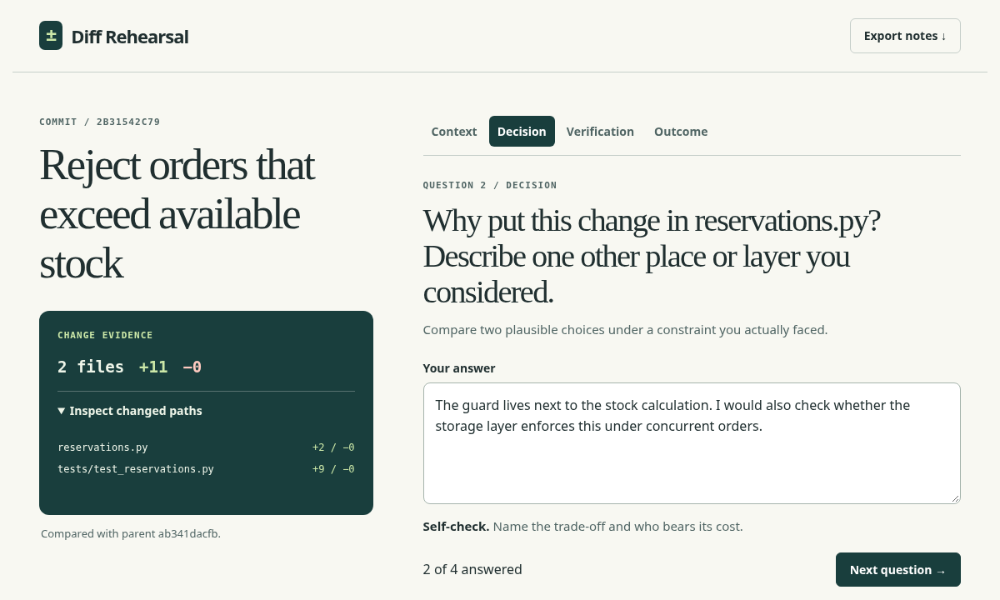

# Diff Rehearsal

Turn one Git commit into a practice interview. Open a self-contained workbook, defend a decision from your own code, and export four answers you can use in a review or interview.

**[Download the example workbook](https://github.com/Rahulchaube1/diff-rehearsal/releases/latest/download/rehearsal.html)** and open it in your browser. The example asks why an inventory check belongs next to the stock calculation and which nearby case the overbooking test could miss. The workbook runs offline and needs no account, model or API key.



## Rehearse a change you shipped

With Python 3.9+ and Git 2.31+ installed, clone this tool and point it at a local project. Replace the example path with the path to your checkout.

```sh
git clone https://github.com/Rahulchaube1/diff-rehearsal.git
cd diff-rehearsal
python3 rehearse.py HEAD --repo /path/to/your/project -o my-rehearsal.html
```

Open `my-rehearsal.html` in a browser. On Windows, use `py` in place of `python3`. You can use a commit SHA, tag or branch in place of `HEAD`. Choose a new output filename for each workbook.

| Round | What to practice |
| --- | --- |
| Context | Explain the previous behavior and who experienced it. |
| Decision | Name a changed file, a plausible alternative and the cost of your choice. |
| Verification | Walk through a test or observation and one case it could miss. |
| Outcome | Cite an observed result or describe how you would measure it. |

Switch between rounds as you work. **Export notes** downloads Markdown at any point. Answers stay in memory until you close or refresh the tab. The HTML includes the commit subject, commit and parent IDs, paths and line counts. Read those details before sharing a workbook generated from a private repository.

## Practice with a coding agent

Copy the `skills/diff-rehearsal` directory into your agent’s skills directory. For a project using Codex, place it under `.agents/skills/` in that project. You can also give the instructions directly to an agent. [Read the skill](skills/diff-rehearsal/SKILL.md)

> Use diff-rehearsal on my last commit. Ask one question at a time. After I explain the design, help me identify one regression test I missed.

The agent can inspect the actual patch and ask follow-up questions. The standalone workbook chooses prompts from changed paths and Git statistics. Its questions will be more specific for some changes than others. Neither workflow can infer your ownership or the effect on users from a line count.

## How Git history is interpreted

A regular commit is compared with its parent. A merge uses the first parent, and a root commit uses the empty tree. The workbook displays binary changes and rename pairs reported by Git. Line totals cover text changes. Empty commits get a question about why they were recorded. A shallow checkout needs the selected commit’s parent locally.

## Development

Run `python3 -m unittest discover -s tests -v` from the repository root. The generator uses Python’s standard library. The public example comes from a fictional two-commit inventory project. Regenerate a copy with `python3 examples/build_demo.py another-example.html`.

For a useful issue, include a small synthetic commit shape, the question the tool generated and the question you would have preferred. [Open an issue](https://github.com/Rahulchaube1/diff-rehearsal/issues)

[Market research and 60-repository dataset](research/README.md) · [MIT License](LICENSE)
